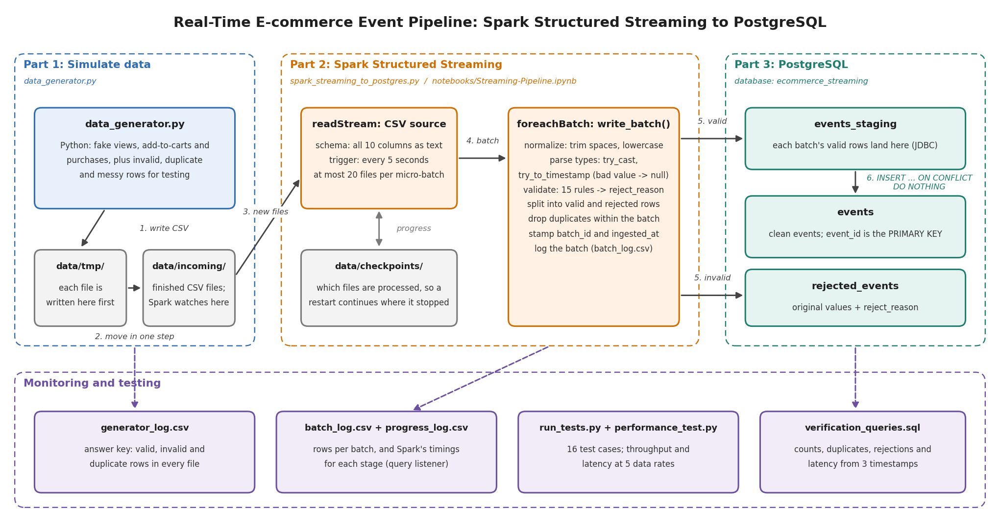

# Real-Time Data Ingestion with Spark Structured Streaming and PostgreSQL

A real-time data pipeline for a simulated e-commerce website. A Python script continuously writes user events (product views, add-to-carts and purchases) as CSV files; **Apache Spark Structured Streaming** picks up each new file within seconds, cleans and validates the events, and stores them in **PostgreSQL**: valid events in one table, and invalid rows in another with the reason they were rejected.

The pipeline was checked with 16 automated test cases and measured at data rates from 10 to 5,000 events per second. In every test and performance run, including 300,000 events at the highest rate, the database matched the generator's record of what it wrote exactly.



## Project deliverables

| Deliverable | Link |
|---|---|
| Data generator (Part 1) | [data_generator.py](data_generator.py) |
| Spark streaming job (Parts 2 and 3) | [spark_streaming_to_postgres.py](spark_streaming_to_postgres.py) |
| Database setup | [sql/postgres_setup.sql](sql/postgres_setup.sql) |
| Connection details | [postgres_connection_details.txt](postgres_connection_details.txt) |
| Project overview | [docs/project_overview.md](docs/project_overview.md) |
| User guide | [docs/user_guide.md](docs/user_guide.md) |
| Test cases | [docs/test_cases.md](docs/test_cases.md) |
| Performance metrics | [docs/performance_metrics.md](docs/performance_metrics.md) |
| System architecture | [docs/system_architecture.png](docs/system_architecture.png) |
| Step-by-step notebook | [notebooks/Streaming-Pipeline.ipynb](notebooks/Streaming-Pipeline.ipynb) |
| Project instructions | [Project_Instructions.md](Project_Instructions.md) |

## How it works

1. **Simulate data.** `data_generator.py` writes a CSV file of events every few seconds. Each file is written to `data/tmp/` first and then moved into `data/incoming/` in one step, so Spark never reads a half-written file. A small share of rows are deliberately invalid, duplicated or badly formatted, to test the cleaning.
2. **Stream with Spark.** Every 5 seconds, Spark takes the new files in `data/incoming/` as one micro-batch. It trims and lowercases values, converts text to numbers and timestamps (invalid values become null instead of stopping the stream), and checks 15 rules, recording the first one each row breaks.
3. **Store in PostgreSQL.** Valid rows are written to a staging table and merged into `events`, skipping any event that's already stored; invalid rows go to `rejected_events` with their original values and the reason. Together with Spark's checkpoint, this makes every write safe to repeat, so a restart or a retried batch never stores an event twice.

See the [project overview](docs/project_overview.md) for the components, data model and design decisions.

## Repository structure

```text
Real-Time-Data-Ingestion/
├── data/
│   ├── incoming/                       # CSV files waiting for Spark (not committed)
│   ├── checkpoints/                    # Spark's record of processed files (not committed)
│   └── metrics/                        # test and performance results (raw logs not committed)
├── docs/
│   ├── project_overview.md             # components, data flow and design decisions
│   ├── user_guide.md                   # setup, running and troubleshooting
│   ├── test_cases.md                   # test plan with expected vs. actual results
│   ├── performance_metrics.md          # throughput, latency and analysis
│   └── system_architecture.png         # architecture diagram
├── notebooks/
│   └── Streaming-Pipeline.ipynb        # the pipeline step by step
├── sql/
│   ├── postgres_setup.sql              # creates the database, user and tables
│   └── verification_queries.sql        # queries for checking the results by hand
├── src/
│   ├── config.py                       # folders, Spark settings, connection details
│   ├── spark_session.py                # creates the Spark session (with the JDBC driver)
│   ├── schemas.py                      # structure of the CSV files
│   ├── transform.py                    # cleaning and validation
│   ├── postgres_sink.py                # writes each micro-batch to PostgreSQL
│   ├── streaming.py                    # the streaming query
│   ├── metrics.py                      # performance measurement (query listener, latency)
│   └── monitor.py                      # helpers for watching and checking results
├── data_generator.py                   # Part 1: simulates the website
├── spark_streaming_to_postgres.py      # Parts 2 and 3: the streaming job
├── check_setup.py                      # checks that Spark and PostgreSQL work
├── run_tests.py                        # runs the 16 test cases
├── performance_test.py                 # measures throughput and latency
├── postgres_connection_details.txt
├── requirements.txt
├── .env.example                        # template for the connection settings
└── Project_Instructions.md
```

## Quick start

You'll need Python 3.11, Java 17 and PostgreSQL. On Windows, Spark also needs `winutils.exe` and `hadoop.dll`. See the [user guide](docs/user_guide.md) for the full setup and troubleshooting.

```powershell
py -3.11 -m venv venv
venv\Scripts\activate
pip install -r requirements.txt
copy .env.example .env
psql -U postgres -f sql/postgres_setup.sql
python check_setup.py
```

Then run the pipeline in two terminals:

```powershell
python spark_streaming_to_postgres.py --reset    # terminal 1: the stream
python data_generator.py                         # terminal 2: the data
```

Stop the generator with Ctrl+C, wait a few seconds, then stop the stream with Ctrl+C.

## Results

**Testing:** 15 of 16 test cases passed. Every functional test passed: files were generated correctly, Spark detected every file, messy rows were cleaned, every kind of invalid row was rejected with the right reason, duplicates were stored once, and restarts and retried batches caused no duplicates. The one failure is a performance finding (see below). [Full test plan](docs/test_cases.md).

**Performance:**

| Data rate | Avg latency | 95th percentile latency | Processing rate while working |
|---|---|---|---|
| 10 events/s | 5.4 s | 6.3 s | 11 events/s |
| 100 events/s | 6.8 s | 9.0 s | 100 events/s |
| 1,000 events/s | 7.6 s | 10.3 s | 906 events/s |
| 5,000 events/s | 10.1 s | 13.8 s | 4,796 events/s |

A backlog of 50,000 events was processed in 7.1 seconds, about 7,000 events per second. Each micro-batch has a fixed cost of about 4.5 seconds on the test machine (Windows), mostly Spark's checkpoint bookkeeping and the separate jobs and connections in each batch, so batches often took slightly longer than the 5-second trigger interval. That only made events wait longer; no data was lost. [Full analysis](docs/performance_metrics.md).

## Tools

Python, Apache Spark (PySpark Structured Streaming), PostgreSQL, psycopg, Pandas, Matplotlib, Jupyter.