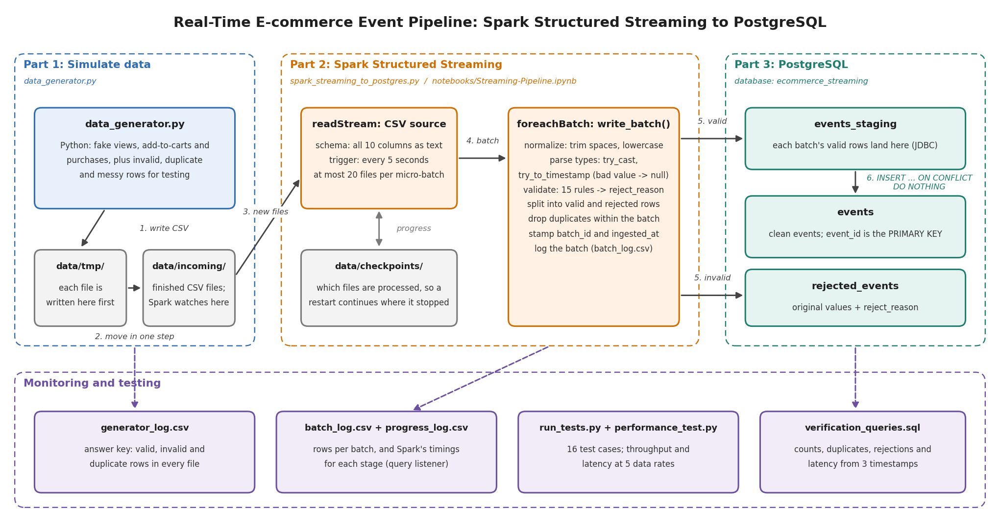

# Project Overview

## What the system does

This project is a real-time data pipeline for a simulated e-commerce website. A Python script plays the role of the website, continuously writing user events (product views, add-to-carts and purchases) as CSV files. Apache Spark Structured Streaming picks up each new file within seconds, cleans and validates the events, and stores them in a PostgreSQL database: valid events in the `events` table, and invalid rows in `rejected_events` with the reason they were rejected.

The pipeline was tested with 16 automated test cases (15 passed) and measured at data rates from 10 to 5,000 events per second. Across every test and performance run, including 300,000 events at the highest rate, the database matched the generator's record of what it wrote exactly: no event lost, duplicated or stored incorrectly.

## Components

| Component | File(s) | Role |
|---|---|---|
| Data generator | `data_generator.py` | Part 1. Writes CSV files of fake events into `data/incoming/`, at a configurable rate. A small share of rows are deliberately invalid, duplicated or badly formatted, to test the cleaning. Every file is recorded in `generator_log.csv`, the answer key for testing. |
| Streaming job | `spark_streaming_to_postgres.py`, `src/streaming.py` | Parts 2 and 3. Watches `data/incoming/` and processes new files as micro-batches every 5 seconds, until stopped with Ctrl+C. |
| Cleaning and validation | `src/transform.py`, `src/schemas.py` | Turns raw text into clean, typed values, and gives every row that breaks a rule a `reject_reason`. |
| Database writer | `src/postgres_sink.py` | Writes each micro-batch to PostgreSQL in a way that is safe to repeat. |
| Database | `sql/postgres_setup.sql` | Creates the database, a dedicated user, and the three tables. |
| Configuration | `src/config.py`, `src/spark_session.py`, `.env` | Folders, Spark settings and database connection details, in one place. |
| Monitoring | `src/metrics.py`, `src/monitor.py` | A Spark listener that records every batch's timings; helpers that check results against the answer key. |
| Testing | `run_tests.py`, `performance_test.py`, `sql/verification_queries.sql` | 16 automated test cases, performance measurement at five data rates, and queries for checking the data by hand. |
| Walkthrough | `notebooks/Streaming-Pipeline.ipynb` | Runs the same pipeline step by step, showing the data at each stage. |

## How data flows through the pipeline

1. **The generator writes a file.** Every few seconds, `data_generator.py` creates a batch of events and writes them to a CSV file in `data/tmp/`.
2. **The file is handed over in one step.** The finished file is moved into `data/incoming/` with a single rename, so Spark can never read a half-written file.
3. **Spark detects new files.** Every 5 seconds (the *trigger interval*), Spark lists `data/incoming/`, takes every file it hasn't processed yet (up to 20), and treats them as one **micro-batch**. Its checkpoint folder records which files each batch used.
4. **Each micro-batch is cleaned.** `write_batch()` trims spaces and lowercases event types, converts text to numbers and timestamps, and checks 15 rules (for example: price above zero, quantity a whole number, event type one of `view`, `add_to_cart` or `purchase`). The first rule a row breaks becomes its `reject_reason`.
5. **Rows are written to PostgreSQL.** Valid rows are deduplicated within the batch and written to `events_staging`; invalid rows go to `rejected_events` with their original values.
6. **Valid rows are merged into `events`.** One SQL statement copies the batch from staging into `events`, skipping any `event_id` that is already stored. Spark then marks the batch as finished in its checkpoint.

Each event carries three timestamps, `event_time` (when the user acted), `ingested_at` (when Spark processed it) and `inserted_at` (when it reached the `events` table), which together measure the pipeline's latency.

## Data model

| Table | Contents | Key rules |
|---|---|---|
| `events` | Clean, valid events: one row per event. | `event_id` is the primary key, so no event can be stored twice. Check constraints reject unknown event types and non-positive prices or quantities, as a final safety net. |
| `events_staging` | A temporary landing table for each micro-batch's valid rows. | Emptied before and after every batch. |
| `rejected_events` | Rows that failed validation, with their original text values and the reason. | Each batch's rows are replaced if the batch is retried. |

## Key design decisions

**Files are handed over atomically, with unique names.** Spark reads any file that appears in the folder it watches, so a file still being written could be read half-finished. The generator therefore writes each file to `data/tmp/` and moves it in one step. File names include the run's start time, because Spark skips any file name it has already processed: a new run reusing an old name would be silently ignored.

**Every column is read as text, and validated explicitly.** If Spark read `price` as a number, a value like `"abc"` would silently become null and be indistinguishable from a missing value. Reading text first lets the cleaning decide what is valid, record *why* a row was rejected, and keep its original values for inspection.

**Invalid values become null instead of stopping the stream.** Spark 4 runs in ANSI mode, where a plain `cast()` of an invalid value fails the whole job. The cleaning uses `try_cast()` and `try_to_timestamp()`, so one bad value rejects one row rather than crashing the stream.

**Writes are safe to repeat.** If Spark fails partway through a batch, it runs the batch again after restarting. Each batch is therefore written through a staging table and merged with `INSERT ... ON CONFLICT (event_id) DO NOTHING`, and the batch's rejected rows are replaced rather than added. Together with the checkpoint, this means every event is stored exactly once, which test cases TC13 and TC14 confirm.

**The pipeline has its own database user.** `streaming_user` owns only the project's database, instead of the pipeline using the `postgres` superuser. If its credentials leaked, or a bug ran the wrong SQL, nothing outside this database could be affected. The real credentials are read from `.env`, which Git ignores; the credentials in `postgres_connection_details.txt` are for a local practice database, included because the project brief asks for them.

**Spark is tuned for small batches.** Spark's defaults suit large clusters. Shuffle partitions are reduced from 200 to 4, and each micro-batch takes at most 20 files, so that a backlog is processed in steps rather than all at once.

**The pipeline measures itself.** The generator's log records exactly how many valid, invalid and duplicate rows each file contains, and the stream logs every batch, so every run can be checked against an answer key. A Spark listener records Spark's own timings for each stage of every batch, which made it possible to find where processing time goes (see [Performance Metrics](performance_metrics.md)).

**Windows compatibility.** Three Windows-specific problems shaped the setup: PySpark's Python workers crash on Windows with Python 3.12 and newer (so the project uses 3.11); loading the JDBC driver with `spark.jars.packages` also sends it to the Python workers, which crashes them (so the driver is loaded with `spark.jars`); and Ctrl+C on Windows reaches Spark's Java process before Python, so the streaming job's shutdown tolerates Spark having already stopped.

## Results in brief

- **Correctness:** all functional test cases passed. Messy rows were cleaned, every kind of invalid row was rejected with the right reason, duplicates were stored once, and restarts and retried batches caused no duplicates.
- **Throughput:** up to about 7,000 events per second (a backlog of 50,000 events was processed in one 7.1-second batch). The pipeline kept up with 5,000 events per second, at its limit.
- **Latency:** at 10 events per second, events reached PostgreSQL in 5.4 seconds on average; at 5,000 events per second, in 10.1 seconds, with 95% within 13.8 seconds.
- **The one failed test (TC15):** micro-batches took about 5 seconds, slightly longer than the 5-second trigger interval, so the stream sometimes started each batch late. No data was lost; events simply waited longer. The cause is a fixed cost of about 4.5 seconds per batch on Windows, explained in [Performance Metrics](performance_metrics.md).

## Limitations and possible improvements

- **Reduce the fixed cost per batch.** `write_batch()` runs four separate Spark jobs just to count rows, and opens two database connections. Combining the counts into one job and sharing a connection would shorten every batch.
- **Choose the trigger interval to suit the data rate.** A longer trigger (for example 10 seconds) means fewer, larger batches, so the fixed cost is paid less often. That would raise throughput, at the price of higher latency.
- **Use a message broker in production.** A folder of CSV files stands in for what would normally be a message broker such as Apache Kafka, which offers delivery guarantees, replay and multiple consumers.
- **Run on a cluster.** The pipeline runs Spark in local mode on one machine. The same code would run on a cluster by changing the Spark master setting, which would raise its capacity.
- **Deduplicate across longer time spans.** Duplicates across batches are caught by the database's primary key, which is reliable but means the duplicate travels all the way to PostgreSQL. Spark's `dropDuplicatesWithinWatermark()` could remove them earlier, within a time window.
